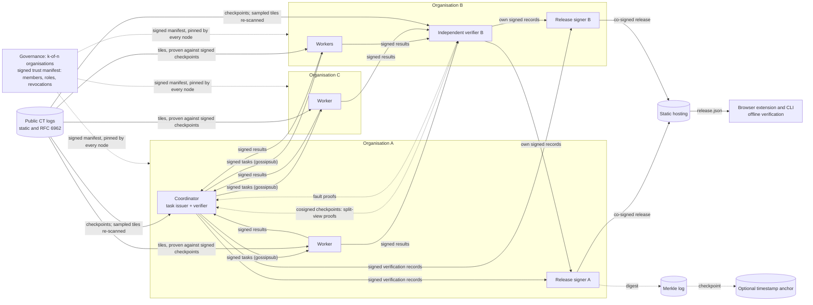
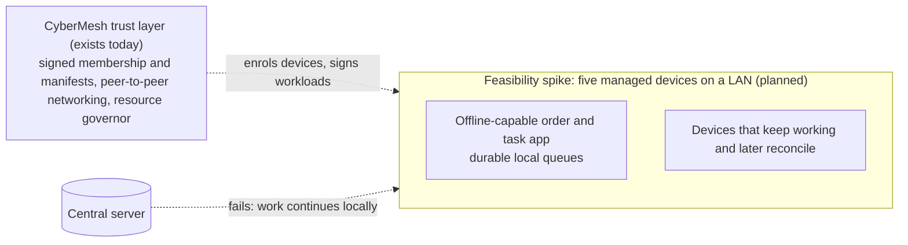

# CyberMesh

*Developed by [VaultBytes Innovations Ltd](https://vaultbytes.com).*

**A decentralised computing and resilience network powered by connected devices.**

CyberMesh aims to transform computers, smartphones, servers, and edge devices into a secure distributed infrastructure that shares available computing resources, supports independently verified cybersecurity services, and enables compatible applications to continue operating during centralised infrastructure failures.

The long-term vision is an open-source continuity layer for businesses, hospitals, airlines, public services, and individuals.

**Current implementation:** CyberMesh v0.3.7 is a research MVP focused on decentralised cybersecurity computation, Certificate Transparency monitoring, independent verification, and cryptographically signed threat intelligence.

**Future development:** Cross-platform mesh execution, distributed application hosting, offline-first state synchronisation, and automatic failover for supported applications.

The goal is to build infrastructure that remains useful when individual servers, cloud providers, or network connections fail.

Today, protection against phishing and malicious websites mostly comes from a few commercial
services that everyone has to trust. CyberMesh explores an alternative: an open network that
organisations join, where computation is contributed, results are independently verified,
and protection is delivered in a form anyone can audit.

How the network works:

1. **Contribute.** Each organisation runs an opt-in worker, capped at about 1 % of one CPU core. It only accepts signed, allow-listed analysis tasks, never runs code from the network, and never touches internal data. Measured usage was 0.03–0.28 % CPU and 9–14 MiB of memory.
2. **Analyse.** Workers run a deterministic, explainable engine over public signals and sign their findings.
3. **Verify.** Findings from independent organisations are checked by recomputation, not by voting. Verification itself can run at several organisations, and the network sets how many must agree before anything is published. A participant that submits a wrong signed answer is caught with proof and quarantined. Colluding organisations cannot force a site to be blocked.
4. **Protect.** Verified findings are published as signed intelligence that several organisations co-sign. Users' browsers verify it offline and warn before a dangerous site opens. No browsing data leaves the device, and protection continues during outages.
5. **Audit.** Every published release is recorded in a Merkle transparency log. The log can optionally be anchored to a public timestamping chain, but anchoring is never needed for protection.

**First application: phishing and malicious-domain protection.** The analysis tasks assess
domain names, and the signed release is the delivery format that browsers consume. The task
system, verification and distribution layers are general; further task types are planned on
the [roadmap](docs/roadmap.md).

**Second application (v0.2.0): Certificate Transparency monitoring.** Workers that opt in split public CT logs into shards and scan every newly logged certificate for brand lookalikes. The network verifies their work against the logs' own Merkle hashes, authenticated by each log's signed checkpoint, and the output is an investigation report for security teams. The organisations' verifiers also witness the logs: they cosign and compare their views, so a log that shows different organisations different trees is caught and proven. Following every public tiled CT log takes about 243 million certificate entries a day: roughly 20–30 workers at a 1 % CPU budget, or one dedicated server. This is the first workload where pooling small donated slices is a natural fit. See [docs/ct-monitoring.md](docs/ct-monitoring.md).

> **Status: research MVP (v0.3.7). Not production-ready.** The evaluation in [docs/evaluation.md](docs/evaluation.md) shows two things.
>
> 1. The *verification and distribution* design works as intended, including against adversarial workers.
> 2. The *lexical detection* adds only a few percent of early detection on phishing domains that feeds have not listed yet.
>
> For cheap lexical analysis, distributed computing gives **no** computational advantage over a single server. The report says so plainly and proposes a better use of donated computing capacity.

## What it protects against (and what it does not)

| Covered | Not covered |
|---|---|
| Visits to hosts listed in a verified release (feed-corroborated phishing/malware hosts, lexically suspicious lookalikes as advisory warnings) | Phishing pages on hosts not in the release; pages behind URL paths on legitimate hosts; attachments, SMS, voice |
| Forged, replayed or tampered tasks, results and releases | A majority of release-signing organisations colluding |
| Colluding or compromised workers trying to get benign domains blocked | Poisoned reference feeds that the verifier itself trusts (mitigated, not eliminated) |
| Network outages (cached, still-valid releases keep working offline) | Users who dismiss advisory warnings |

## Architecture at a glance

### Implemented in v0.3.7



Governance signs who may take part and in which role. Each organisation runs its own workers, verifier and release signer, so no single organisation decides what is published. Workers analyse domains and certificate-log tiles, and verifiers recompute rather than trust them. Verifiers that witness a CT log also compare views, so a log that shows organisations different trees is caught and proven. Faults proven by one verifier are re-checked by the coordinator before it acts. Consumers verify releases offline.

### Planned: a continuity exploration (not implemented)



Concept only, and kept as a separate track from CyberMesh releases. After the CT evaluation, a two-week spike will test whether a small stateful workflow survives the loss of its central server without losing or duplicating operations. Failover and state replication move into the architecture above only if it succeeds. Raspberry Pi, browsers and phones would come in later phases, with roles that depend on each device. See the [roadmap](docs/roadmap.md).

Details: [docs/architecture.md](docs/architecture.md) · protocol: [docs/protocol.md](docs/protocol.md) · threat model: [docs/threat-model.md](docs/threat-model.md) · privacy: [docs/privacy.md](docs/privacy.md) · anchoring: [docs/blockchain.md](docs/blockchain.md) · verifying binaries: [docs/build-integrity.md](docs/build-integrity.md)

**Organisations interested in running a node:** see the [pilot invitation](docs/pilot.md), the [operator guide](docs/operator-guide.md) and, for your security team, [what running a node exposes you to](docs/node-risk.md).

## Quick start

Requirements: Rust 1.98.1 (pinned via `rust-toolchain.toml`), Python 3 (helper scripts), and optionally Docker and Node 22 (browser extension).

```bash
# Build and run every test (unit, property, real-libp2p integration and adversarial)
cargo test --workspace --all-features

# Full local demonstration as separate processes on 127.0.0.1:
#  5 organisations, 6 workers (one simulated compromised), coordinator, release
#  co-signing, offline verification, transparency log and local-chain anchoring.
scripts/demo-local.sh --keep-serving

# The same demonstration with Docker Compose (hardened, cgroup-limited containers)
deploy/docker/demo.sh up
deploy/docker/demo.sh down
```

Then load the browser extension (see [apps/browser-extension/README.md](apps/browser-extension/README.md)) and open
`http://examplebank-secure-login.phish.localhost:8088/` — a locally served, clearly labelled
test page for a fictional bank — to see the warning. A step-by-step walkthrough is in
[docs/demo.md](docs/demo.md).

## Repository layout

| Path | Purpose |
|---|---|
| `crates/cybermesh-crypto` | Ed25519 identities, DSSE envelopes, strict canonical JSON, digests |
| `crates/cybermesh-protocol` | Versioned wire messages, governance-signed trust manifest, validation, replay cache, rate limiter |
| `crates/cybermesh-analysis` | Deterministic `DomainRiskAssessment` engine, evidence bundles, evaluation metrics |
| `crates/cybermesh-verifier` | Result binding, recomputation, conflict and fault detection, classification policy, reputation |
| `crates/cybermesh-intelligence` | Deterministic, multi-signed releases; appeals and corrections; rollback; offline verification |
| `crates/cybermesh-anchor` | RFC 9162 Merkle log and proofs, anchoring trait, local test chain, OpenTimestamps codec/client |
| `crates/cybermesh-network` | Permissioned libp2p gossipsub transport (Noise, allowlist, rate limits, bounded queues) |
| `crates/cybermesh-node` | Worker runtime with resource governor; coordinator and independent verifier runtimes |
| `apps/cybermesh-cli` | `cybermesh` command-line tool |
| `apps/browser-extension` | Chromium MV3 extension (offline verification, warnings, strict mode) |
| `tests/` | End-to-end, adversarial and performance tests over real libp2p |
| `datasets/demo` | Demo evidence (synthetic feed, Majestic top-10k subset, brand table, hosting platforms) |
| `deploy/` | Dockerfile, Compose demo, hardened systemd unit, macOS `launchd` daemons |
| `vendor/if-watch` | Third-party `if-watch` 3.2.2 on the netlink 0.9 crates (drops `paste`); see its `VENDORED.md` |
| `docs/` | Architecture, protocol, threat model, privacy, anchoring, evaluation, operator guide, roadmap |

The proposed `cybermesh-core`, `cybermesh-consensus`, `cybermesh-reputation`, `cybermesh-worker` and dashboard packages were deliberately
not created as separate crates; see [docs/architecture.md](docs/architecture.md#crate-boundaries).

## Security

Please report vulnerabilities privately — see [SECURITY.md](SECURITY.md). Three independent internal
reviews (two security passes and one correctness review) were performed and their findings fixed; they are summarised in
[docs/security-review.md](docs/security-review.md). Further internal reviews of the CT monitoring code and of independent verifiers (v0.2.0) are
summarised there too. No external audit has been performed.

## Licence

Copyright © 2026 VaultBytes Innovations Ltd.

Apache License 2.0 — see [LICENSE](LICENSE) and [NOTICE](NOTICE). Demo data licences are listed in
[datasets/demo/evidence/NOTICE.md](datasets/demo/evidence/NOTICE.md).
