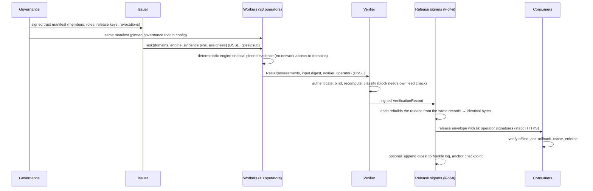
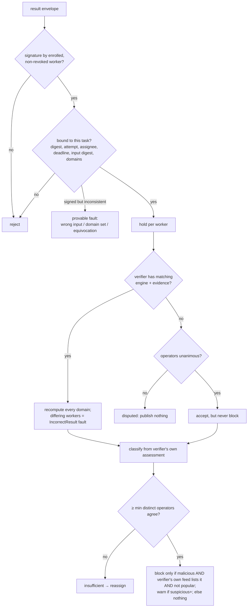

# Architecture

This document describes the CyberMesh MVP as implemented in v0.1.0, the reasons behind each
major decision, and the security trade-offs of each.

## 1. Roles

| Role | Holds | Does | Trusted for |
|---|---|---|---|
| **Governance** (k-of-n, default 2-of-3 organisations) | governance keys | signs the trust manifest (who participates, in which role), revocations, appeal decisions | membership and revocation |
| **Operator** | — | an organisation; unit of independence for all diversity requirements | running its own nodes honestly *or being caught* |
| **Worker** | worker key | runs allow-listed analysis tasks on pinned evidence, signs results | nothing — every result is checked |
| **Issuer** | issuer key | creates and assigns signed tasks | task content (but cannot forge results or releases) |
| **Verifier** | verifier key | authenticates, binds and recomputes results; signs verification records | classification of what may be published |
| **Release signer** (k-of-n distinct operators, default 2-of-3) | release key | rebuilds the release deterministically and co-signs it | releases (threshold) |
| **Consumer** (browser extension, CLI) | pinned trust root | verifies releases offline, enforces | — |

In the demo the issuer and verifier share one key held by organisation A; a production
deployment should separate them and run verifiers at more than one organisation.

## 2. Data flow

## 3. Components

### 3.1 Signing envelope and canonical encoding (`cybermesh-crypto`)

- **DSSE envelopes.** Each message is a [DSSE](https://github.com/secure-systems-lab/dsse) envelope. Signatures cover the pre-authentication encoding `DSSEv1 len(type) type len(body) body`, so verifiers check signatures over the exact bytes received and never re-serialise. Each message kind has its own payload type, so a signature over a task can never be accepted as a result.
- **Ed25519.** Verification uses `verify_strict`, which rejects weak keys and non-canonical signatures.
- **Canonical JSON.** Payloads are encoded as compact JSON with a fixed field order. Structs reject unknown fields and use `BTreeMap` for maps, and contain no floats. On decode the value is re-encoded, and the bytes must be identical. This removes every source of malleability: whitespace, key order, escapes, duplicate keys and floats.

*Trade-off.* JSON is larger than a binary format, but it can be read and audited by hand, and the browser verifies it without a parser dependency. The browser does not re-check canonical form, because signatures cover the exact bytes.

### 3.2 Protocol (`cybermesh-protocol`)

- **Messages.** The protocol defines task, result, heartbeat, appeal decision and trust manifest, all at version 1. See [protocol.md](protocol.md).
- **Validation.** Validation is pure: it takes bytes, the manifest, the time and limits.
  - The signer must hold the required role and must not be revoked.
  - The identity claimed in the payload must equal the signer.
  - A worker's claimed operator must match the manifest.
  - Freshness, TTL and size limits are enforced, and domains must be normalised.
- **Stateful layers.** The caller applies the stateful checks:
  - a bounded replay cache, which fails closed when full;
  - per-peer token buckets.

### 3.3 Analysis engine (`cybermesh-analysis`)

`DomainRiskAssessment` is the only task kind. It uses only the domain string and locally pinned evidence snapshots:

- **Evidence.** The engine uses reference blocklists, a popularity list, a brand table and a hosting-platform list. Each source is pinned by `H(id, kind, file digest)`.
- **Signals.** Each signal is an explainable `Finding` with integer points:
  - feed match and popularity exemption;
  - brand impersonation, lookalikes (deleet and edit distance) and IDN homographs (a confusables skeleton);
  - mixed scripts;
  - phishing vocabulary, hyphens, subdomain depth, length, entropy (fixed-point integer `log2`), digit density, and frequently abused TLDs.
- **Determinism.** The engine uses integer arithmetic only, sorted outputs, and no clock or randomness. The PSL and IDNA tables are pinned exactly and their versions are part of `ENGINE_VERSION`. Golden vectors pin the output digest.
- **No network access.** The engine never resolves, fetches or contacts a domain. Workers never fetch suspicious sites.

*Trade-off.* Lexical analysis is cheap, private and safe, but weak (see [evaluation.md](evaluation.md)). Stronger signals such as passive DNS, certificate transparency or page content need either network access to suspicious infrastructure or larger data feeds. They are deferred.

### 3.4 Verification (`cybermesh-verifier`)

Key properties:

- **No majority voting.** The engine is deterministic, so any disagreement is a fault that recomputation can attribute to a specific worker. Without recomputation, disagreement is recorded as `disputed`.
- **Operators, not keys.** Diversity is counted per organisation. A worker's claim of a different operator is rejected.
- **Collusion cannot cause a block.** A `block` needs the verifier's *own* feed corroboration. Classification uses the verifier's own assessment, not worker claims. This was a HIGH finding of the internal security review, now fixed and covered by a regression test.
- **Reputation is operational only.** It drives assignment and quarantine and is never used as evidence that a domain is malicious. A single provable fault quarantines the worker until governance reinstates it.

*Trade-off.* Recomputing everything makes worker compute redundant for this task type. That is the honest consequence of choosing a cheap, deterministic engine: the network provides independent attestation and fault detection, not compute capacity. See [evaluation.md §5](evaluation.md#5-does-decentralised-computation-help).

### 3.5 Releases (`cybermesh-intelligence`)

- **Deterministic build.** The input is verification records, governance-verified appeal decisions and explicit parameters (sequence, `issued_at`, TTL). The newest record per domain wins, which allows de-listing. Entries and corrections are sorted, so input order cannot change the output bytes.
- **Signing.** Release signers from at least *threshold* distinct operators each rebuild the release and sign the identical payload. Signatures are merged.
- **Consumer checks.** Consumers check that:
  - signatures come from at least the threshold of distinct operators;
  - the network id is correct;
  - the release has not expired and its lifetime is at most 30 days;
  - text fields are printable and bounded, and entries are sorted;
  - anti-rollback holds: no older sequence, no equivocation at the same sequence, no sequence jump over 10⁶, and the `previous` link matches.
- **Corrections.** An upheld appeal removes the indicator and its subdomains and is listed publicly. Only fresh, feed-corroborated `block` evidence dated after the decision can list it again.
- **Rollback.** Older content is republished under a *new* sequence. Consumers never accept older sequences.

### 3.6 Anchoring (`cybermesh-anchor`)

- **Transparency log.** The log is an RFC 9162 Merkle tree of `{sequence, release_digest}` entries, with inclusion and consistency proofs.
- **Anchors.** The checkpoint commitment is 32 bytes, `H(log_id, size, root)`, and is sent to an `Anchor`. Two anchors are implemented:
  - a local hash-chained test chain;
  - OpenTimestamps, which uses calendar submission, offline proof evaluation, and bounded, allow-listed upgrade.
- **Off the protection path.** Anchoring never blocks publication or enforcement. See [blockchain.md](blockchain.md).

### 3.7 Networking (`cybermesh-network`)

- **Transport.** libp2p over TCP, with Noise XX for mutual authentication with Ed25519 peer keys, and Yamux.
- **Admission.** An allowlist built from the manifest admits peers, and connection limits apply.
- **Dissemination.** Gossipsub with strict signing and **manual validation**: a message is forwarded only after the application has verified it.
- **Message ids.** A message id is `H(author ‖ data)`, so a relay cannot pre-claim an honest message's id.
- **Rate limits.** Token buckets are kept per *author*, and a message costs 1 plus its size in KiB.
- **Bounded queues.** Queues are bounded, and drops are counted.
- **Outbound budget.** Outbound bandwidth has a budget.
- **Reconnection.** The node redials bootstrap peers after a partition. Workers keep results in a bounded outbox until the task deadline.

*Trade-off.* Discovery is a static bootstrap list, which is enough for a 10–20 node permissioned pilot. Kademlia, mDNS and gossipsub peer scoring are listed in the roadmap.

### 3.8 Worker runtime and resource governor (`cybermesh-node`)

- **Admission.** The worker accepts only tasks of the allow-listed kind, from enrolled issuers, with engine and evidence pins matching its local snapshot. There is no code, URL or command in a task.
- **Resource budgets.**
  - CPU: a token bucket on measured *process* CPU, 1 % of a core by default, averaged over a 60 s window.
  - Memory: a budget of 200 MiB.
  - Load: work pauses when the system load is high.
  - Time: UTC working-hour windows.
  - Queue: a bounded task queue.
  - Network: an outbound bandwidth budget.
- **Administrator control.** A `PAUSE` or `STOP` file in the control directory takes effect within 250 ms. Workers also handle `SIGTERM` and `SIGINT`. Status is written to `status.json`, and `cybermesh worker status` displays it.
- **Enforcement level.** The worker enforces these limits cooperatively, inside its own process. OS-level enforcement is recommended in addition: the systemd unit in `deploy/systemd` (`CPUQuota=`, `MemoryMax=` and sandboxing) and Docker `cpus` and `mem_limit`. Measurements are in [evaluation.md](evaluation.md#4-worker-resource-usage).

### 3.9 Browser extension (`apps/browser-extension`)

- **Updates and verification.** The extension is MV3. It fetches the release over the network, verifies it with WebCrypto Ed25519 against the bundled trust root, and stores it with anti-rollback state.
- **Enforcement.** It installs one `declarativeNetRequest` **block** rule per listed host for main-frame requests, so the request to the listed host is never sent. The service worker then shows the warning page in that tab. Redirect rules were tested first, but Chromium silently ignores them without host permission for the blocked site, so they fail open. A test covers this behaviour.
- **Warn versus block.** `warn` entries always show a dismissible interstitial. `block` entries are dismissible unless strict mode is enabled, either by the user or by enterprise policy.
- **Privacy.** No browsing data leaves the browser. False-positive reports open a prefilled GitHub issue that the user reviews and submits manually.

## 4. Crate boundaries

The mission brief proposed `cybermesh-core`, `-consensus`, `-reputation`, `-worker` and a dashboard. The implementation consolidates these:

| Proposed | Implemented as | Why |
|---|---|---|
| `cybermesh-core` | `cybermesh-protocol` | The shared types *are* the protocol. A separate core crate would be empty. |
| `cybermesh-consensus` | `cybermesh-verifier` | The MVP has no distributed consensus (by design: deterministic recomputation, not voting). The name "consensus" would mislead. |
| `cybermesh-reputation` | `cybermesh-verifier::reputation` | It is about 100 lines and used only by the verifier. |
| `cybermesh-worker` | `cybermesh-node::worker` | The worker and coordinator share config, file and governor code. |
| `apps/dashboard` | `cybermesh worker status`, `coordinator-report.json` | Operators get a status file and CLI. A web dashboard would add an attack surface without improving the MVP. |

## 5. Extensibility

- **New task kinds.** Add a `TaskKind` variant plus an engine. The worker allowlist and payload types stay strict: unknown kinds are rejected, not ignored.
- **Verification for expensive tasks.** Tasks the verifier cannot cheaply recompute, such as certificate transparency shard scans, would need sampled re-execution by independent operators. The `Policy` and record types leave room for this, and the [roadmap](roadmap.md) describes it.
- **Other anchors.** Further anchors implement the `Anchor` trait. Receipts are tagged enums, so they can be verified offline per adapter.
